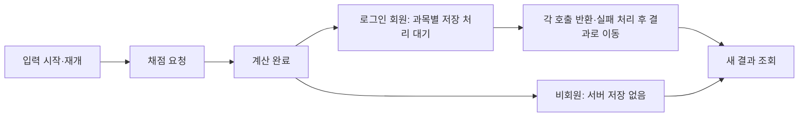

# 관리자 이용통계 고도화 설계안

후속 상태: 사용자가 미리보기 적용을 승인하여 [실제 앱 로컬 구현·검증](admin-analytics-enhancement-implementation.md)을 완료했다. 아래 내용은 설계/미리보기 작성 당시의 기록이며 운영 반영은 아직 하지 않았다.

작성: 2026-10-15 KST · 상태: 제안 · 실제 UI/수집/DB 변경 및 배포 없음

2026-10-16 재검토 반영: [추가 고도화 검토](admin-analytics-enhancement-review.md). 대표 지표 확정을 유보하고, 저장 대기와 결과 표시의 실제 순서, 기능 사용 기회, 코호트 관찰 창 검증을 보완했다. 아래 단계는 추가 검토 문서의 우선순위와 함께 적용한다.

추가 검토를 반영한 [독립 화면 미리보기](admin-analytics-enhancement-preview.md)를 제공한다. 실제 앱·DB·수집은 변경하지 않았으며 화면의 모든 자료는 가상이다.

## 1. 목표와 권장 범위

운영자가 **이용량 변화 → 변화가 발생한 기능과 단계 → 반복 학습으로 연결되는지 → 자료를 신뢰할 수 있는지**를 한 흐름으로 확인하게 한다. 기존 7개 탭과 수집·인가 구조를 유지하고, 먼저 품질 정보와 채점 분석을 보완한다.

우선순위는 다음과 같다.

| 단계 | 개선 | 운영자가 답할 질문 | 구현 경계 |
|---|---|---|---|
| P0 | 수집 품질 노출 복구, 지표별 필터 범위, 장기 발행 상태 | 숫자가 줄었는가, 자료가 부족한가? | 기존 자료와 API 확장 중심 |
| P1 | 채점 단계별 퍼널, 이용 변화 분해, 반복 이용 간격, 기능 교차 이용 | 어디에서 멈추며 다시 이용하는가? | 기존 이벤트 집계 우선, 대기시간·기능 노출은 추가 계측 필요 |
| P2 | 답안 수정·분야 분석·메모 계측, 저장의 서버 확인 | 새 기능을 쓰는가, 실제 저장됐는가? | 수집 계약·서버 처리 확장 |
| P3 | 충분한 이력 기반 변화 탐지, 푸시 성과 연결, 집계 내보내기 | 어떤 변화에 대응해야 하는가? | 데이터 축적·별도 운영 정책 선행 |

**첫 출시 권장 범위는 P0의 품질 표시·집계 정확성 확인 + 채점 퍼널이다.** 재방문은 신규 지표 추가 전에 후속 관찰 날짜의 가용성부터 검증한다. 기존 재방문과 PWA 분석은 이미 있으므로 새 기능으로 다시 만들지 않는다. 모든 제안 UI는 명시적 승인 뒤 구현하며, 이 문서는 화면 변경 승인을 대신하지 않는다.

## 2. 확인한 현재 상태

### 코드·문서

- [통계 페이지](../src/pages/AdminAnalyticsPage.tsx)는 개요·기능·채점·회원/재방문·회원 활동·PWA·관리자 조회 이력을 제공한다.
- [대시보드](../src/components/admin/AdminDashboard.tsx)는 6개 지표 카드, 기간 비교, 일평균 추이, 주요 변화, 기능 이용, 입력→결과 관측률, PWA, 오늘 잠정 수치, 최근 회원 활동을 제공한다.
- [수집 계약](../supabase/functions/_shared/analytics-contract.ts)에는 입력 시작/재개·채점 요청/완료·새 결과 조회·과목별 저장 응답과 기출·이력·지원 분석·PWA 신호가 있다. 원본 상세 조회는 최대 90일이다.
- D1/D7/D30, 확인 후 7일 내 첫 채점, 현재 보관 이력은 이미 있다. 가입·확인 시각, 이용 이벤트, 현재 KV 보관량은 서로 다른 출처다.
- **품질 노출 공백:** `AnalyticsContent`는 개요에 `AdminDashboard`를 렌더링한다. 기존 `ReportView`의 수집 품질은 `tab === 'overview'`일 때만 표시되므로 현재 라우트의 분기로 접근할 수 없다. 대시보드에는 수집 상태와 최근 수락 시각은 있으나 제출/거절/처리 실패 상세가 없다. 정적 코드 확인이며 실제 관리자 로그인 화면 검증은 하지 않았다.
- 답안 수정·분야 펼침 전용 이벤트는 현재 허용 목록에 없다. 문항 분포 열기는 이미 계측돼 있으므로 중복 추가하지 않는다.

### 원격 읽기 전용 확인

2026-10-15 23:08 KST, 기존 프로젝트 `jkxxtyaanyhmjbdtybkp`를 Management API의 읽기 전용 쿼리로 확인했다. 개인 이름·이메일·답안·원본 활동 행은 조회하지 않았다.

| 항목 | 확인 결과 | 설계에 주는 의미 |
|---|---|---|
| 수집 설정 | enabled, metric version 1 | 기존 수집을 재사용 |
| 수집 시작 | 2026-10-04 16:27 KST | 시작 이전의 이용을 복원해 표시하지 않음 |
| 이벤트 | 2,539행, 마지막 수신 2026-10-15 23:05 KST, source는 client만 관측 | 건수는 이벤트 행이며 방문자·회원 수가 아님 |
| 장기 발행 | `product_usage_day_publications` 0행, `product_usage_fact_days` 0행 | 장기 조회를 지탱할 발행 운영이 아직 필요 |
| 알려진 중단 기록 | 0행 | 실제 무누락·무장애의 증거로 해석하지 않음 |
| 권한 | product_* 12개 테이블 RLS 활성, 클라이언트 정책 및 PUBLIC/anon/authenticated 테이블 grants 없음 | 기존 private 저장 구조 유지 |
| 통계 RPC | 조회된 11개 모두 SECURITY INVOKER, anon/authenticated 실행 불가, service_role 실행 가능 | Edge 인가 및 SQL 관리자 재검사 유지 |
| 마이그레이션 | 통계·대시보드·사용자 데이터·최근 활동 4개 버전 모두 존재 | 일부 과거 문서의 '최근 활동 미적용' 표기는 현재 원격 이력과 다름 |

이 시점에는 수집 개시 후 약 11일만 지났다. 완료된 전체 KST 날짜는 10/5~10/14이며 D30이나 완전한 30일 비교를 제공할 근거가 없다. 6개월/1년 선택 기능이 있다는 사실과 해당 기간 자료의 존재를 구분한다. 이 확인은 스키마·권한 메타데이터와 집계 상태이며 실제 역할별 실행·부하·운영 UI 검증을 대체하지 않는다.

## 3. 지표 정의

기존 지표 이름과 의미를 조용히 바꾸지 않는다. 새 지표에는 별도 계산 버전을 두고, 이벤트 형식 버전과 구분한다. 과거와 현재 정의가 다르면 비교하지 않는다.

| 지표 | 제안 정의와 분모 | 용도·제한 |
|---|---|---|
| 활성 회원 | 현재 정의의 기간 내 DISTINCT 회원 | 기존 카드 유지. 비회원 세션과 더해 '전체 사람 수'로 만들지 않음 |
| 핵심 이용 회원 | 기존 `is_core` 정의에 해당하는 기간 DISTINCT 회원 | 화면 탐색을 실제 기능 이용과 구분. 첫 단계에서 핵심 정의 자체는 변경하지 않음 |
| 주간 반복 채점 회원 | 완료된 최근 7일 중 서로 다른 KST 2일 이상에 공식 채점 완료 또는 사설 저장 성공을 한 회원 | 후보 보조 지표. 복습 이용과 실제 학습량을 대표하지 않음 |
| 반복 채점 비율 | 위 회원 ÷ 같은 7일 내 공식 채점 완료/사설 저장 성공 회원 | 분모 0이면 미계산. 성적 향상의 증거로 표현하지 않음 |
| 새 결과 관측률 | 기존 관찰 종료 입력 세션 중 같은 행위자·흐름·실행의 새 결과가 관측된 세션 비율 | 기존 지표와 분모 유지. 미관측을 확정 장애로 해석하지 않음 |
| 단계 전환율 | 4장의 연결 가능한 흐름/실행 중 다음 단계 관측 수 ÷ 해당 단계 관측 수 | 회원·세션·입력 흐름·실행·과목 저장을 혼합하지 않음 |
| 주간 재이용 W1 | 최초 핵심 이용일 D 기준 D+7~D+13에 핵심 이용한 회원 ÷ 해당 관찰 창 전체가 지난 관측 가능한 최초 이용 회원 | 기존 정확한 D7과 별도 표시. 최초 여부 불명·자료 공백 제외 |
| 기능 교차 이용 | 기간 내 두 기능의 핵심 행동을 모두 한 DISTINCT 회원 | 동시 사용 관계이며 인과·순서가 아님. 익명 이용은 세션 내 관계만 제공 |
| PWA 재이용 | 기존 PWA 최초 핵심 이용 코호트 | 설치 수·설치 유지율과 구분. 브라우저와 단순 비교하여 효과를 단정하지 않음 |

대표 지표는 아직 확정하지 않는다. 채점·복습의 실제 재이용 간격과 완료된 7일/28일 내 이용일 분포를 먼저 확인한다. 주 2일 채점은 후보 보조 지표로 남기고, 기록이 있는 이력/과거 결과 조회를 별도 복습 관측으로 분석한다. 지표 정의 변경 시 계산 버전을 올린다. 실제 학습량·시험 성적 향상으로 해석하지 않는다.

공통 규칙:

- KST 날짜, 서버 수신 시각, `[시작, 종료 다음 날)` 경계를 유지한다. 오늘은 잠정 패널에 분리한다.
- 기간 DISTINCT와 일평균·일별 합계를 구분한다. 분모·관찰 완료 수·관측 범위·자료 시점을 함께 반환한다.
- 상태를 `0건 / 부분 관측 / 미가용 / 미성숙 / 미지원 필터 / 조회 실패`로 구분한다. 상태 없는 0으로 대체하지 않는다.
- 첫 화면은 최근 완료된 7일. 비교 구간 중 일부가 수집 전이면 증감률을 숨긴다.
- 초기의 작은 코호트는 건수와 분모 중심으로 보여 준다. 기존 주요 변화의 표본 제한을 유지하고 대시보드에서 순위 경쟁을 유도하지 않는다.
- D1/D7/D30과 W1은 완전 관측된 회원을 분모로 사용한다. 신규/복귀 분류에서 수집 전 회원을 신규로 재분류하지 않는다.

## 4. 채점 퍼널

현재 이벤트를 연결하되 처리 순서와 집계 분모를 구분한다. `HomePage.handleGrade`는 계산 뒤 과목별 저장 호출을 순서대로 기다린 다음 결과 화면으로 이동한다. 따라서 저장 대기가 결과 도달 지연에 영향을 줄 수 있다. 저장 성공률과 결과 관측률은 별도 지표로 집계하며, 저장 실패 후에도 결과 화면으로 이동할 수 있다.



**두 가지 집계 단위를 분리한다.**

1. 입력 퍼널: `(actor_scope, session_id, input_flow_id)`를 한 흐름으로 보고 입력→요청→계산→결과의 도달 여부를 각 1회 집계한다. 같은 흐름의 여러 실행은 성공한 연결 실행이 하나라도 있는지 판단한다. 기존 세션 관측률은 별도 보존한다.
2. 실행 진단: `(actor_scope, grading_run_id)`별 요청→계산→결과를 보여 준다. 두 과목 동시 채점은 실행 1회이고 저장 응답은 과목별 최대 2개다. 저장 재시도 식별자는 `save_attempt_id`로 구분한다.

입력 코호트는 최초 입력 수신일로 고정하고 조회 종료일 이후의 연결 결과도 관찰 마감까지 확인한다. 기존 open/grace/observation_closed/uncertain 규칙을 재사용한다. 계정 전환 전후나 익명→회원은 소급 연결하지 않는다. 중복 UUID/의미 키를 재수신해도 집계가 늘지 않는다. 도착 순서가 뒤바뀌어도 연결 ID로 판별한다.

요청 없이 계산/결과만 남은 경우는 앞 단계를 추정해서 채우지 않고 '연결 불완전'으로 별도 집계한다. 관찰 종료 후 다음 단계가 없는 경우는 '다음 단계 미관측'이다. 브라우저 닫기·통신 실패·수집 차단과 실제 사용자 이탈을 완전히 구분할 수 없다.

저장 분모는 로그인 상태로 계산 완료된 실행의 예상 저장 대상 과목이다. 두 과목 중 한 과목만 성공하면 실행 전체 성공으로 표시하지 않는다. 응답 이벤트의 unknown과 이벤트 자체가 없는 미관측을 나눈다. 비회원의 저장 없음은 실패가 아니다.

필터는 다음처럼 제한한다.

| 분석 | 허용 제안 | 주의 |
|---|---|---|
| 입력 퍼널 | 시작 시점 채널·OS·기기·로그인·학년도·문형 | 입력 때 확정되지 않은 과목/저장 결과 필터는 미지원 |
| 실행 진단 | 요청 시점 속성·과목 조합 | `both`는 실제 두 과목 실행. 단일 과목과 자동 합산하지 않음 |
| 저장 진단 | 로그인 실행·저장 대상 과목 | 결과별 분류는 출력 항목이며 성공 결과로 전체 분모를 미리 필터링하지 않음 |

채점 대기시간의 최소 계측은 P1의 별도 수집 작업으로 검토한다. 서버 수신 간격은 배치 전송의 영향을 받으므로 실제 입력 소요시간·계산 지연으로 표시하지 않는다. 동일 문서의 단조 시계로 계산·과목별 저장 대기·결과 표시까지 구간을 분리하고, 전체 경과시간과 화면이 보이는 동안의 시간을 구분한다. 완료된 실행의 시간 분포와 완료되지 않은 실행 비중을 함께 제시한다. 상관 ID·허용 속성·수집 버전 확장이 필요하며 현재 자료로 소급 계산하지 않는다.

## 5. 화면 변경 제안

기존 관리자 경로와 7개 탭을 유지한다. 다음은 승인용 배치안이며 실제 앱에 적용하지 않았다.

```text
개요
 ├─ 최근 완료 7일 / 30일 / 6개월 / 1년 · 실행 채널 · 비교
 ├─ 관측 상태: 수집 시작 / 가용 날짜 / 마지막 수락 / 장기 발행
 ├─ 기존 주요 지표 6개
 ├─ [P1] 반복 채점/복습 관측 · 재이용 간격 · 분모
 ├─ 주요 변화 최대 3개 → 해당 탭과 동일 조건 상세
 ├─ 이용 추이 · 기능별 변화 · 채점 요약 · PWA
 ├─ [P0] 수집 품질 상세 펼치기
 └─ 오늘 잠정 현황 · 최근 회원 활동

채점
 ├─ 적용 중 필터 + 미지원 필터 안내
 ├─ 기존 입력 세션 → 새 결과 관측률
 ├─ [P1] 입력 흐름 퍼널 + 실행 진단
 └─ 과목별 저장 응답: 성공 / 실패 / 미확인 / 미관측

회원/재방문
 ├─ 기존 가입·확인·첫 채점·D1/D7/D30
 ├─ [P1] W1 재이용 · 주간 학습일 수 분포
 └─ 현재 보관 현황: 기간 통계와 별도 표시
```

P0의 UI 승인 범위는 개요의 관측 상태·품질 상세, 탭별 필터 안내와 상태 문구다. P1은 채점 퍼널·회원 반복 이용·기능 교차 이용 표시 추가다. 일반 서비스 화면의 디자인·본문·동선 변경은 범위에 포함하지 않는다.

공통 필터는 지표별 지원 계약을 따르게 한다. 미지원 선택은 이유를 보여 주며, 몰래 전체로 재해석하지 않는다. 가입/현재 보관량/수집 품질처럼 적용되지 않는 필터는 패널에 명시한다. 개인 회원 선택은 전체 통계 모수를 바꾸지 않는다.

카드→상세 이동에는 기간·채널·지원 가능한 조건만 전달한다. 90일 제한으로 잘리면 원래 범위와 실제 조회 범위를 모두 표시한다. 회원 ID와 이름/이메일 검색어는 URL·localStorage에 저장하지 않는다. 모바일은 카드/퍼널을 세로로 쌓고 정확한 숫자 표와 키보드 접근을 제공한다.

## 6. 데이터와 운영 구조

### P0/P1: 기존 수집 재사용

`usage-events → private.product_usage_events / activity_days / first_usage → admin-analytics → 관리자 화면`을 유지한다. 기존 `analyticsClient`의 큐·계정 경계·실패 격리를 재사용하고 외부 분석 SDK를 추가하지 않는다.

집계 응답에는 다음 정보를 제안한다. 이는 신규 계약 제안이며 현재 API에 존재한다고 가정하지 않는다.

- 지표 키·계산 버전·값·단위·분자/분모·상태·상태 이유.
- 요청 기간·실제 관측 범위·자료 생성 시점·적용/미지원 필터.
- 원본/발행 자료 출처와 발행 세대, 비교 가능 여부.

`dashboard`/`report`를 호환 가능한 필드로 확장하고 품질·퍼널·재이용의 계산 코드를 분리한다. P0에서 전체 리팩터링을 하지 않는다. 개인 이벤트 배열을 브라우저에 내려서 전체 통계를 계산하지 않는다.

현재 `dashboard_source`는 최소 사실 행을 Edge에 전달해 계산한다. 이용 증가 시 사실 행 전송량이 커질 수 있으므로 대표 7/30/366일의 응답 크기·실행계획·지연을 먼저 측정한다. 문제가 확인되면 DB에서 DISTINCT와 구간 집계를 완료해 집계 DTO만 반환하도록 개선한다. 지금 2,539개 이벤트만으로 성능 장애라고 단정하지 않는다. 인덱스 추가는 실제 쿼리 계획 확인 후 결정한다.

### 장기 발행

기존 `product_analytics_publish_days`와 두 private 발행 테이블을 재사용한다. 현재 0개 발행일이므로 우선 완료일을 읽기 전용으로 대조하고, 실제 발행은 별도 운영 적용 요청에서 수행한다.

- P0: 마지막 발행일·미발행 날짜·원본 조회 범위 만료 전에 발행이 필요한 날짜를 표시한다.
- 최초 도입: 현재 원본 가용 범위 안의 완료일만 수동 발행·대조한다. 수집 시작일은 부분 자료로 유지한다.
- 자동화는 후속 승인 범위: 예를 들어 KST 02시에 전일까지 발행하고 최근 3일을 재대조하는 운영안을 검토한다. 동일 날짜 잠금·원자 교체·재시도 멱등성·실패 시 기존 세대 유지를 지킨다.
- 현재 발행 RPC는 관리자 actor를 요구한다. 스케줄러에 임의의 관리자 UUID를 넣어 우회하지 않는다. 기계 실행용 권한·감사 주체·호출 경로를 별도 설계한 뒤 자동화한다.
- 원본과 발행본은 날짜별 하나의 출처만 사용한다. 현재 사실 테이블에는 OS·기기·시험·흐름/저장 세부 속성이 없으므로 장기 상세 필터나 퍼널이 자동으로 지원되지는 않는다.
- 관리자 데이터 삭제·수정과 발행 잠금/재생성 계약을 유지한다. 원본이 달라진 뒤 오래된 파생 자료가 다시 나타나지 않도록 검증한다.
- 논리 조회 범위 90일/25개월과 물리 보존·삭제는 별개다. 자동 삭제·보존 정책 변경을 이 고도화에 묶어 실행하지 않는다.

### P2 신규 계측 후보

| 제안 이벤트 | 발생 시점 | 추가 속성 최소안 |
|---|---|---|
| `answer_edit_started` | 사용자가 답안 수정을 시작 | 학년도·과목·문형·상관 ID |
| `answer_edit_completed` | 로컬 적용 또는 서버 저장 결과 확인 | 저장 여부·결과 enum·상관 ID; 신규 채점과 별도 |
| `field_analysis_opened` | 분야를 실제로 펼침 | 분야 식별자·학년도·과목; 펼치기 중복 방지 |
| `note_save_outcome` | 메모 저장 요청의 결과 확인 | 결과 enum·상관 ID; 메모 본문 제외 |
| 서버 저장 확인 신호 | 공식/사설 이력이 실제 커밋됨 | 연산 ID·과목·서버 확정 시각; 답안/점수 제외 |

새 이벤트는 허용 목록·클라이언트·Edge·DB 검증 계약을 함께 확장한다. 기존 이벤트는 계속 수락하며 구형 클라이언트와 병행 가능한 순서로 배포한다. 새 지표는 계측 시작 이후만 가용하며 이전 0건을 생성하지 않는다.

서버 저장 확인은 클라이언트 `history_save_outcome`과 합산하지 않는다. 현재 SQL의 source 제약은 client 전용이므로 단순히 source 값을 바꾸는 방식으로 구현할 수 없다. 별도 연산 사실/전달 기록 또는 호환 확장이 필요하며 원자성·멱등성·실패 복구를 먼저 설계한다. 핵심 저장 처리의 오류 격리를 포함해 P2 작업으로 분리한다. `service-activity`의 최근 이용 시각은 마지막 시각 요약이므로 과거 세션·코호트 복원의 근거로 사용하지 않는다.

## 7. 수집 품질과 해석

품질 패널은 수집 enabled, 최초 개시, 마지막 새 수락, 수락·중복·거절·처리 실패, 알려진 중단, 장기 발행 범위, 지표 버전을 보여 준다. 채널/시험 필터가 적용되지 않는 카운터에는 '선택 기간 전체 수집'을 표시한다.

전송 시도·재시도 카운터와 고유 이벤트 건수는 분모가 다를 수 있다. 기존 카운터 정의를 유지하고 실패 건수를 곧바로 최종 누락률로 계산하지 않는다. 서버에 도달하지 않은 이벤트의 총수는 현재 구조에서 알 수 없다.

마지막 수락이 오래됐다는 사실만으로 장애 경보를 만들지 않는다. 저이용 시간대와 구분할 근거가 필요하다. 신규 오류 추적에는 안전한 오류 코드·버전·지연 분포만 수집하고 토큰·원본 URL·이메일·답안·GPA·메모/게시글/채팅 본문을 포함하지 않는다.

P3 변화 탐지는 완료된 가용 자료가 충분히 쌓인 뒤 도입한다. 기존 정책 2를 기준으로 최소 표본·절대 차이·변화율을 함께 사용하며 수집 공백·계산 버전 변경이면 판단을 중단한다. 같은 요일 비교는 최소 4주, 시험 전후 비교는 실제 해당 시즌 자료가 있는 경우만 제공한다. 표시 내용은 변화와 근거 수치이며 원인을 자동 확정하지 않는다. 이메일/푸시 자동 보고는 별도 요청 전까지 추가하지 않는다.

## 8. 권한·검증·릴리스

기존 AuthContext/AdminRoute, Edge JWT·현재 관리자 역할 확인, SQL 실제 actor 재검사를 유지한다. private 테이블에 일반 회원 접근을 열지 않는다. 개인 목록/상세 감사와 응답의 원자성, 감사 실패 시 응답 중단을 보존한다. 401/403에는 전체 관리자 자료와 늦은 응답을 제거하고 일시 오류의 이전 자료에는 기준 시각을 표시한다.

P3의 CSV는 우선 집계 수치만 검토하며 기간·필터·정의·상태·자료 시점을 포함한다. 개인 이름/이메일/원본 활동 대량 반출은 초기 범위에서 제외한다. PWA·푸시·서비스 활동은 각 수집 목적과 식별 범위가 달라 자동 연결하지 않는다.

| 검증 | 핵심 합격 기준 |
|---|---|
| 집계 | 두 과목 실행 1회/저장 2건, 동일 이벤트 재수신, 여러 탭, 계정 전환, 역순 도착에도 정의 일치 |
| 퍼널 | 기간 밖 연결 결과, 진행·유예·미확정, 연결 누락, 익명 저장 제외, 과목별 부분 성공을 정확히 구분 |
| 재이용 | 정확한 D7과 W1 구분, 미성숙/공백/최초 불명 제외, KST 자정·월말·윤년 경계 |
| 장기 | 발행 없음과 완료 0건 구분, 원본/발행 중복 없음, 재발행 실패 롤백, 삭제 후 파생 무효화 |
| 권한 | 익명·일반 회원 거절, 관리자 회수·계정 전환·감사 실패 시 개인정보 잔존 없음 |
| UI | 320/390/1280px, 키보드·표 대체, 지원하지 않는 필터, 상세 기간 절단, 오류와 0건 구분 |
| 부하 | 대표 기간과 예상 증가량의 합성 데이터로 측정. 15초 클라이언트 제한 내 응답, 초기 목표 p95 2초 이내(측정 후 확정) |

구현 시 기존 `test:analytics`, `test-dashboard-sql.ts`, Vitest, 관리자 Playwright를 확장하고 `npm run check`를 통과한다. 운영 Supabase에 연결된 브라우저에서는 통계 테스트 이벤트·저장·제출을 발생시키지 않는다. 쓰기 검증은 합성 DB/모의 API 또는 별도 승인된 검증 환경에서 수행한다.

릴리스는 **추가 DB 계약 → 호환 Edge → 웹 → 수집/집계 대조 → 승인된 발행 운영** 순서다. 롤백은 신규 패널/집계를 비활성화하고 기존 이벤트 수락을 유지한다. 원본 삭제나 되돌리기 어려운 데이터 변환을 롤백 수단으로 쓰지 않는다.

## 9. 실행 단위와 완료 조건

1. **P0 품질·관측 범위:** 품질 노출 공백을 해소하고 모든 카드에서 수집 전/부분/0건이 구분된다. 장기 발행 0일이 운영자에게 명확히 보인다. 기존 수집 방식은 유지한다.
2. **P1-A 채점 퍼널:** 기존 이벤트만으로 흐름/실행/과목 저장의 분모를 분리하고 합성 기준 데이터와 수치가 일치한다. 우선 출시 단위다.
3. **P1-B 반복 이용:** 채점/복습의 재이용 간격·7일과 28일 이용일 분포·W1·교차 이용을 검토한다. 주 2일 채점은 보조 지표이며 D30을 조기 표시하지 않는다. 지표별 가용 날짜와 관찰 완료 분모를 보여 준다.
4. **P2 기능·서버 확인:** 새 이벤트의 시작일·버전·중복 방지·동작 실패 격리를 검증한다. 실제 저장 성공과 클라이언트 응답 관측을 비교할 수 있다.
5. **P3 운영 분석:** 충분한 이력을 확보한 뒤 이상 변화·푸시 후 재이용·집계 내보내기 중 실제 운영 수요가 있는 항목만 진행한다.

P0/P1을 하나의 거대한 화면 교체로 묶지 않고 독립 검토 가능한 작업으로 나눈다. 구현 시 영향에 맞춰 `docs/domain.md`, `docs/architecture.md`, `docs/database.md`, `docs/development.md`와 기존 통계 운영 문서를 함께 갱신한다.

이번 작업은 설계 문서만 추가했다. 코드·DB·수집·배포 변경이 없으므로 애플리케이션 테스트나 빌드를 실행하지 않았다. 문서 링크와 diff 공백 검사를 수행한다. 설계 검토 후 문서만 별도 커밋할 수 있으며 `main` push는 배포를 유발하므로 현 단계에서는 권장하지 않는다.

참고: [기존 통계 설계](admin-analytics-design.md), [현재 통계 구현](admin-analytics.md), [대시보드 구현](admin-dashboard-implementation.md), [운영 적용 기록](admin-analytics-rollout.md), [Supabase 읽기 전용 API 공식 문서](https://supabase.com/docs/reference/api/v1-read-only-query).
